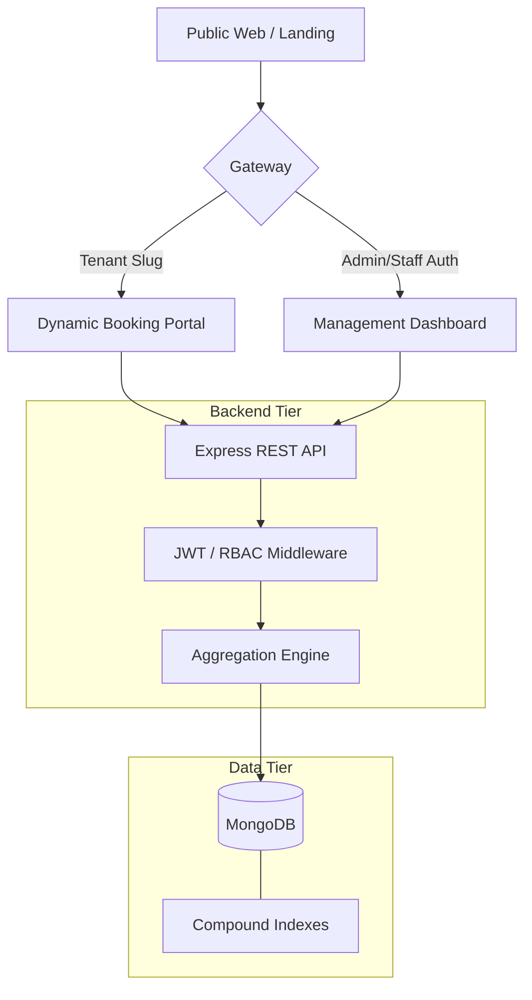

# BookFlow – Premium Multi-Tenant SaaS Booking Platform

[](https://opensource.org/licenses/MIT)
[](https://github.com/AbdulKaleemShaik/bookflow-saas-booking/actions/workflows/ci.yml)
[]()

> A multi-tenant appointment booking platform: each business gets its own isolated booking portal, staff hierarchy, payments and analytics on one shared backend.

---

## ⚡ Technical Core

BookFlow serves many businesses (tenants) from a single backend and database, with every query scoped by `tenantId` so tenants can never see each other's data.

### 🛠️ Tech Stack
- **Frontend:** React 18, Redux Toolkit, **Glassmorphism UI Engine**, Lucide Icons, Date-fns.
- **Backend:** Node.js, Express, **Compression Middleware**, Morgan Logging.
- **Database:** MongoDB with **Mongoose Compound Indexing** (multi-tenant isolation).
- **Caching & Concurrency:** Redis (ioredis) for cache-aside slot caching and distributed booking locks.
- **Security:** Dual-token JWT (Access/Refresh), Hierarchical RBAC, tenant-scoped queries.
- **Payments:** Stripe PaymentIntents API + Webhook Synchronization.
- **DevOps:** Docker, Docker Compose, Kubernetes manifests, GitHub Actions (CI tests + ECR/EKS deploy workflow).
- **Infrastructure:** Provisioned via Terraform.

---

## 🌍 Infrastructure & Deployment

The repository includes everything needed to run BookFlow locally with Docker Compose or on Kubernetes:

- **Containerization**: Fully Dockerized frontend, backend, and database environments for strict development and production parity.
- **Kubernetes**: Manifests in `k8s/` for the backend, frontend, MongoDB, Redis and an Ingress, designed for **Amazon EKS**.
- **CI/CD**: `ci.yml` runs the backend test suite and frontend build on every push and PR; `deploy.yml` builds images tagged with the commit SHA, pushes them to Amazon ECR and rolls them out to the cluster.
- **Infrastructure as Code**: `terraform/` defines the VPC and EKS cluster (terraform-aws-modules).

---

## 🏗️ Architecture Design

BookFlow utilizes a **Single Database, Shared Schema** approach with strictly enforced logical isolation via `tenantId`.



### ⚙️ Caching & Concurrency (Redis)

Redis is an optimisation layer, not a source of truth: if `REDIS_URL` is unset or Redis is down, the API falls back to MongoDB and keeps working.

- **Double-booking prevention:** creating a booking takes a lock per staff member per day (`SET key token NX PX 10000`) before the overlap check and insert, so two concurrent requests for overlapping slots cannot both succeed. The lock is released with a Lua compare-and-delete so a client can never release another client's lock. Recurring bookings lock every affected day.
- **Atomic coupon usage:** a coupon use is consumed with a single conditional `findOneAndUpdate`, so a usage limit cannot be exceeded under concurrency, and is given back if the booking insert fails.
- **Slot caching:** availability lookups are cached per tenant and staff (cache-aside) and invalidated whenever a booking, schedule, absence or service changes.

### 🔐 Advanced RBAC & Hierarchy
We implemented a professional **"Reports To"** hierarchy allowing for complex organizational management:
- **Super Admin**: Platform-wide visibility and tenant management.
- **Tenant Admin**: Full control over their business, services, and staff.
- **Manager**: Controls their own bookings and the bookings of staff who **report to them**.
- **Staff**: Secure, restricted view of only their assigned appointments.
- **Customer**: Clean, high-performance checkout experience.

---

## ✨ Enterprise-Grade Features

| Feature | Detail |
|---|---|
| **💎 Premium UI** | Dynamic glassmorphism booking portal with real-time checkout summary. |
| **🎟️ Coupon Engine** | Percentage/Fixed discounts with min-spend and validity logic. |
| **⏳ Waitlist System** | Intelligent queue management with hierarchical staff allocation. |
| **⭐️ Verified Reviews** | Integrated rating system linked to completed appointments. |
| **📅 Availability Logic** | Multi-layer slot calculation: Staff Schedules - Absences - Breaks - Existing Bookings. |
| **📊 Analytics Suite** | Real-time revenue trends, peak occupancy, and staff performance metrics. |
| **📧 Notification Pipeline** | Automated HTML emails for booking confirmations, changes, and cancellations. |

---

## 🚀 Getting Started

### 1. Environment Configuration
Copy `backend/.env.example` to `backend/.env` and fill it in, for example:
```bash
PORT=5000
MONGO_URI=mongodb://localhost:27017/bookflow
REDIS_URL=redis://localhost:6379   # optional
JWT_SECRET=your_super_secret_key
JWT_REFRESH_SECRET=your_refresh_secret
STRIPE_SECRET_KEY=sk_test_...
EMAIL_USER=your_smtp_user
EMAIL_PASS=your_smtp_pass
CLIENT_URL=http://localhost:5173
```

### 2. Rapid Development Setup
```bash
# Install & Start Backend
cd backend
npm install
npm run dev

# In another terminal: Install & Start Frontend
cd frontend
npm install
npm run dev
```

### 3. Run everything with Docker Compose
```bash
docker compose up --build   # MongoDB, Redis, backend (:5000) and frontend (:5173)
```

### 4. Database Seeding (Optional)
```bash
# Seed initial roles and a test coupon
cd backend
node src/utils/seedRoles.js
node seed-coupon.js
```


---

## 🧪 Testing

The backend has **53 Jest + Supertest tests** running against an in-memory MongoDB (`mongodb-memory-server`) and `ioredis-mock`, so no external services are needed:

| Suite | Covers |
|---|---|
| `auth` | Registration, login, token refresh |
| `tenantIsolation` | Tenant A cannot read or modify tenant B's services, staff or bookings |
| `rbac` | Role-based access denials |
| `booking` | Booking creation, validation, overlap conflicts, concurrent double-booking (only one wins) |
| `coupon` | Discount maths, limits, expiry, atomic usage |
| `lock` | Lock acquire/release semantics and fallback without Redis |
| `cache` | Cache hits, invalidation on writes, fallback when Redis is down |

```bash
cd backend && npm test
```

---

## 📸 Dashboard & Portal
*Beautiful, responsive interfaces for both administrators and customers.*

> [!TIP]
> **Pro Discovery:** Try visiting `/onboard` to see the seamless business registration flow, then head to `/book/tailor` to experience the world-class customer journey.

---
© 2026 BookFlow. All rights reserved.
